# Seamlex Portal — Cheatsheet

Claude plugin that runs a customer's **relevamientos** (requirements interviews) with a Product Owner persona, in business language only, and leaves the result in Jira + GitHub.

## At a glance

| | |
|---|---|
| Commands | `/hi-seamlex` (start session, run first) · `/seamlex-refinar [KEY]` (run a relevamiento) · `/seamlex-project-status` (live sprint + docs status) |
| Skills | `delivery-how-to` (Jira/GitHub house rules) · `business-analysis` (interview method) |
| MCP | Atlassian (bundled, browser OAuth) · GitHub (you add it, own token) |
| Source of truth | Customer's GitHub docs repo `seamlex-docs-<customer>` → `README.md` + `config.yml` |
| Leaves behind | `relevamientos/<KEY>.md`, transcript, 2 Jira comments, `Pendiente:` sub-tasks, task ↔ file link |

## What is loaded in memory

Loaded by `/hi-seamlex`, kept for the whole session (never summarised to the customer):

| Loaded | From | Used for |
|---|---|---|
| `cloudId` | Atlassian (`getAccessibleAtlassianResources`) | every Jira call |
| User name + locale | `atlassianUserInfo` | `{{USER_NAME}}`, language of outputs |
| Repo (`{{GITHUB_ORG}}/{{GITHUB_REPO}}`) | search `seamlex-docs-*` in the Seamlex org, or named by the user | all GitHub reads/writes |
| `README.md` | repo root | the **Map**: which files hold project knowledge |
| `config.yml` | repo root | the `{{PLACEHOLDER}}` settings (below) |
| `delivery-how-to` skill | plugin | repo structure, Jira task shape, labels, JQL/path patterns |

Loaded later by `/seamlex-refinar`:

| Loaded | When |
|---|---|
| `business-analysis` skill | before Step 1 (interview rules + technical-term → business-question table) |
| Task, epic, comments, sub-tasks | Step 2 |
| `scope.md`, Discovery Brief, `glosario.md`, `features-no-identificados.md`, last 2–3 minutas | Step 2 (from the README Map) |
| Existing `relevamientos/<KEY>.md` | Step 2 → means **resumed session** |

**`config.yml` keys** (edit in GitHub, no plugin release needed; plugin never edits it):

`JIRA_PROJECT` · `TYPE_TASK` (sub-task type) · `LABEL_REQUEST` · `LABELS_EXTRA` · `CONFIRM_WRITES` (`always` = approve every write) · `DETAIL` · `DRAFTS_DIR` · `PROGRAM` · `COMPANY`

> Nothing is stored per workspace. No secrets in `config.yml` or the repo, ever.

## How to use it — process diagram

```mermaid
flowchart TD
    start([Start a Claude session]) --> hi["/hi-seamlex"]

    subgraph S[Session setup — read-only]
        hi --> a1{Atlassian signed in?}
        a1 -- No --> a2[Browser sign-in]
        a2 --> a3
        a1 -- Yes --> a3{GitHub MCP answers?}
        a3 -- No --> a4[Add github MCP + token, restart] --> a3
        a3 -- Yes --> r1[Settle docs repo seamlex-docs-*]
        r1 --> r2[Load README.md + config.yml]
        r2 --> r3[Load delivery-how-to skill]
    end

    r3 --> ref["/seamlex-refinar [KEY]"]

    subgraph R[Relevamiento]
        ref --> k1[Load business-analysis skill]
        k1 --> k2[JQL: open sprint + label relevamiento]
        k2 --> k3{How many tasks?}
        k3 -- None --> stop1([Stop: nothing in sprint])
        k3 -- Several --> k4[Customer picks one]
        k3 -- One --> k5
        k4 --> k5[Gather: task, epic, scope, brief, glossary, last minutas]
        k5 --> k6[Reflect back in 5–8 lines, ask for corrections]
        k6 --> k7[Interview in small AskUserQuestion batches<br/>live Artifact redrawn each interaction<br/>file saved as it goes]
        k7 --> k8[Closing summary]
        k8 --> k9{Customer says yes?}
        k9 -- No --> k7
    end

    k9 -- Yes --> w0{Approve the whole set of writes}

    subgraph W[Outputs — in this order]
        w0 --> w1[4a Minuta relevamientos/KEY.md]
        w1 --> w2[4b Jira comment + file URL]
        w2 --> w3[4c Transcript file + Jira comment]
        w3 --> w4[4d Pendiente sub-tasks, keys written back]
        w4 --> w5[4e Task ↔ file link]
    end

    w5 --> d1{Summary approved, design covered,<br/>no blocking pendiente?}
    d1 -- Yes --> done([Finalizado + task to Done])
    d1 -- No --> prog([En progreso — list what's missing])
```



## Setup (≈5 min)

1. **Get access** — repo is private; your Seamlex contact grants your GitHub account read access first.
2. **Install**
   ```
   /plugin marketplace add julio-seamlex/seamlex-portal
   /plugin install seamlex-portal@seamlex
   ```
   Desktop app / claude.ai: Customize → Plugins → Personal plugins **+** → Add marketplace → From a repository. If it can't sync a private repo, use Claude Code.
3. **Restart Claude fully** (MCP servers load at startup).
4. **Add GitHub MCP once**, user scope, with your own token (`repo` scope):
   ```
   claude mcp add --transport http github https://api.githubcopilot.com/mcp/ \
     --header "Authorization: Bearer <token>" --scope user
   ```
   Never `--scope project` (it would put your token in a shared file). Restart again. Check with `claude mcp list`.
5. **Run `/hi-seamlex`**, approve the `atlassian` server, sign in via browser.
6. Per session: `/hi-seamlex` → `/seamlex-refinar`.

Nothing to configure locally; engagement settings live in the repo's `config.yml`.

## Key concepts

- **Business language only.** Whatever the task says (record type, flow, LWC…), the customer hears questions about their operation. Platform vocabulary appears only in the minuta's closing *Para el equipo de delivery*.
- **Nothing invented.** Unanswered = `⚠️ TBD — <question> — <owner>`, and each becomes a `Pendiente:` sub-task.
- **Approval first.** Drafts are shown before any write to Jira/GitHub (`CONFIRM_WRITES: always`). Marking done is a separate explicit yes.
- **Requirements table is the core of the minuta.** One row per need: `REQ-ID` (`<KEY>-R<n>`, stable, append-only), capability, actor, testable statement, source (verbatim quote), MoSCoW, complexity 1–10, in/out of scope, open questions.
- **Process diagram required** for every process in *Process context* (Mermaid, actor swimlanes, decisions labelled, REQ-IDs on steps).
- **Live Artifact.** The requirements template renders as an Artifact, filled in as the interview advances and re-rendered after every interaction. The GitHub file remains the record.
- **Files found by path, not labels.** `relevamientos/<KEY>.md` and `<KEY>-transcript.md`; Jira key is in the path and front matter. No GitHub labels/topics.
- **Jira labels** set at creation: `{{LABEL_REQUEST}}`, `{{LABELS_EXTRA}}`, plus kind (`relevamiento`, `pendiente`).
- **Pending items are sub-tasks** of the relevamiento (never linked standalone issues), summary `Pendiente: …`, sprint inherited.
- **Unidentified features.** Anything raised that belongs to no sprint task goes to `features-no-identificados.md`; Seamlex decides its fate.
- **Resumed sessions.** An existing `relevamientos/<KEY>.md` is continued, never duplicated; existing pendientes aren't re-created.
- **Finalizado vs En progreso.** Finalizado only if the customer approved, the *Ready for design* checklist holds, and no pendiente blocks design. Never marked done to tidy the board.
- **Failures.** A write fails → stop, report what did/didn't land, no blind retry.
- **Credentials.** Atlassian via your own browser OAuth; GitHub via your own token. Seamlex never sees either.

## Repo layout (customer docs repo)

```
README.md  config.yml  scope.md  glosario.md  features-no-identificados.md
discovery/discovery-brief.md
relevamientos/<KEY>.md   relevamientos/<KEY>-transcript.md
```

Local workspace: only `seamlex/discovery/` (optional Discovery Brief copy).

## Troubleshooting, fast

| Symptom | Fix |
|---|---|
| Atlassian tools missing | Restart Claude, approve the `atlassian` server, rerun `/hi-seamlex` |
| GitHub tools missing / auth error | Redo step 4 of Setup, restart |
| "No documentation repo found" / missing README/config | Tell your Seamlex contact which account you used |
| Wrong project key / sub-task type | Fix in `config.yml` (Seamlex does it) |
| `marketplace add` can't find repo | Access grant hasn't landed — ask your contact |
| No relevamiento found | Needs label `relevamiento`, open sprint, not Done; or pass the key: `/seamlex-refinar ABC-12` |
